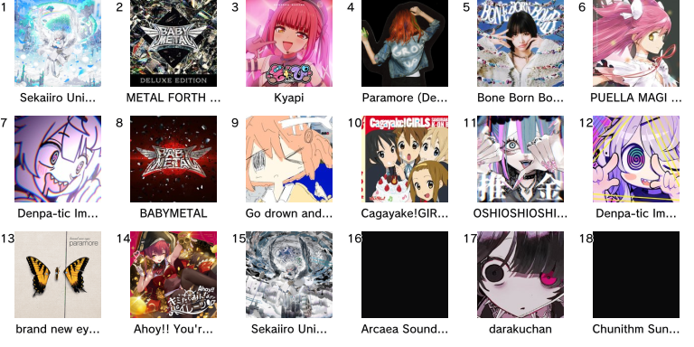

# Hi! I'm Raymond.

I am a self-taught programmer. I enjoy programming in Rust and sometimes C/C++. I also do homelabbing and occasional frontend work (with SvelteKit and TypeScript).

My profile picture is of Red Savarin from Solatorobo; [かなとふぐ (via Pixiv)](https://www.pixiv.net/en/artworks/116972716) is the artist (it can be removed upon their request).

## Interests

I like to play arcade rhythm games, especially the one featuring a cute little penguin :penguin: and another with magical girls :magic_wand:

### Music

> [!NOTE]
> I switch between Apple Music and Spotify, sometimes the list below is a little spotty

